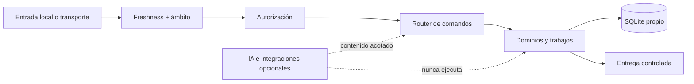

# Botsky

> Asistente local-first para WhatsApp: comandos explícitos, automatización práctica y permisos verificables.

[](pyproject.toml)
[](docs/RUNTIME.md)
[](tests/)
[](ESTADO_COMPARTIDO.md)

Botsky reconstruye un asistente operativo independiente alrededor de una idea sencilla: **la IA puede generar contenido, pero nunca decide ni ejecuta comandos por su cuenta**. El núcleo trabaja con almacenamiento propio, validación de ámbito y una política de permisos explícita.

## Qué hace

- Interpreta comandos canónicos y peticiones acotadas en lenguaje natural.
- Gestiona notas, descargas, conversiones, archivos, búsquedas, agenda y trabajos locales.
- Integra capacidades opcionales de Drive, IA, audio, vídeo, avatar y llamadas.
- Mantiene recepción, autorización, ejecución y entrega como etapas separadas.
- Procesa mensajes sintéticos localmente para probar flujos sin activar proveedores remotos.
- Conserva recibos, estados, límites y resultados en SQLite propio.

> **Estado operativo:** el núcleo local está activo y en evolución. Los conectores externos son opt-in y requieren configuración explícita; ejecutar el CLI no inicia WhatsApp, IA ni otros proveedores automáticamente.

## Principios de diseño

| Principio | Aplicación |
| --- | --- |
| Local-first | SQLite, fixtures y trabajos propios antes de cualquier integración externa. |
| Autoridad explícita | Actor, chat, grupo, bot, época y permisos se validan antes de ejecutar. |
| IA acotada | La IA produce contenido; el router y las políticas deciden qué se puede ejecutar. |
| Trazabilidad | Cada operación conserva recibo, estado, resultado y evidencia reproducible. |
| Fallo seguro | Mensajes viejos, ámbitos no permitidos y acciones ambiguas se rechazan. |

## Arquitectura



La separación detallada está en [docs/ARCHITECTURE.md](docs/ARCHITECTURE.md).

## Inicio rápido

```bash
git clone https://github.com/Yzy-zu/Botskys.git
cd Botskys
python3.14 -m venv .venv
source .venv/bin/activate
pip install -e .
cp config.example.toml config.toml

# Inicializa únicamente el almacenamiento propio
botsky --config config.toml init

# Prueba el parser sin DB, IA ni proveedores
botsky parse "/nota guardar comprar pan"

# Simula una entrada local y entrega el resultado por stdout
botsky --config config.toml local "/nota guardar comprar pan"
```

Para capacidades opcionales instala solo el extra necesario:

```bash
pip install -e ".[media,ai,integrations,rtc]"
```

## CLI local

| Comando | Uso |
| --- | --- |
| `botsky parse "..."` | Analiza un comando sin tocar DB ni proveedores. |
| `botsky local "..."` | Simula una entrada de operador local. |
| `botsky init` | Inicializa el almacenamiento propio. |
| `botsky work` | Ejecuta trabajos locales pendientes. |
| `botsky tick` | Reserva notificaciones locales vencidas. |
| `botsky deliver <id>` | Acepta por stdout partes pendientes de un recibo. |

La referencia completa de comandos está en [docs/commands.md](docs/commands.md).

## Configuración mínima

Copia `config.example.toml` a un archivo privado y revisa, como mínimo:

- `database`: ruta de la base SQLite propia.
- `timezone`: zona usada por presentaciones y agenda.
- `owner`, `friends` y `allowed_groups`: límites de identidad y ámbito.
- `transport`: transporte seleccionado para el entorno actual.
- `activation_at`, `max_age_seconds` y `max_future_seconds`: ventana temporal de mensajes.

No subas secretos, sesiones, bases de datos ni la carpeta `private/`. Las integraciones y sus límites están documentados en [docs/INTEGRACIONES.md](docs/INTEGRACIONES.md).

## Desarrollo y validación

```bash
# Suite Python
PYTHONPATH=src .venv/bin/python -m unittest discover -s tests -v

# Suite Node del subsistema audiovisual
node --test calls/test/*.test.cjs

# Lint configurado
ruff check .
```

Los cambios de comportamiento deben incluir pruebas locales y mantener la separación entre fixtures, evidencia histórica y datos operativos.

## Documentación

- [Guía de uso](docs/GUIA_BOTSKY.md)
- [Arquitectura y límites](docs/ARCHITECTURE.md)
- [Runtime y despliegue](docs/RUNTIME.md)
- [Integraciones opcionales](docs/INTEGRACIONES.md)
- [Activos y permisos](docs/ACTIVOS_Y_PERMISOS.md)
- [Estado compartido](ESTADO_COMPARTIDO.md)
- [Índice de comandos](docs/commands.md)
- [Evidencia histórica](docs/evidencia/)

## Licencia y estado

Este repositorio es una reconstrucción independiente y conserva documentación de campañas, pruebas y decisiones anteriores. La evidencia histórica no sustituye al código actual ni autoriza por sí misma una integración o transición operativa.
