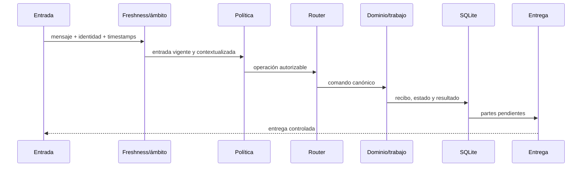

# Arquitectura de Botsky

Botsky está organizado como un núcleo local con integraciones optativas. La ruta normal de una operación es:



## Capas

### Entrada y contexto

`botsky.adapters`, `botsky.ingress` y `botsky.contracts` normalizan entradas locales o de transporte. La entrada conserva actor, chat, grupo, bot, mensaje citado, adjuntos y timestamps.

Antes de llegar al router se comprueba la ventana temporal y el ámbito. Un mensaje antiguo, futuro o fuera del grupo permitido no se convierte en una operación.

### Autorización

`botsky.access` aplica permisos por operación y contexto. La autorización se vuelve a comprobar en el punto de ejecución; no se confía únicamente en una validación anterior.

### Router y dominios

`botsky.commands` convierte texto en comandos canónicos. Los dominios agrupan capacidades concretas: archivos, descargas, búsqueda, agenda, juegos, Minecraft, audiovisual y administración.

La IA y los proveedores externos pueden aportar texto o datos dentro de contratos concretos, pero no tienen acceso al ejecutor general ni al parser de comandos.

### Persistencia y trabajos

`botsky.store` conserva recibos, estados, resultados, colas y límites en SQLite. `botsky.jobs`, `botsky.scheduler` y `botsky.local_files` procesan trabajos locales con guardas de concurrencia, cancelación y reintentos controlados.

### Entrega

`botsky.delivery` separa la aceptación del resultado de su envío. El transporte stdout sirve para pruebas y fixtures; los transportes externos requieren configuración propia y no se inician implícitamente.

## Integraciones optativas

Las capacidades opcionales viven fuera del camino mínimo:

- `media`: documentos, imágenes, PDF, hojas de cálculo y presentaciones.
- `ai`: proveedores de generación y síntesis de voz.
- `integrations`: clientes HTTP y servicios externos.
- `rtc`: audio/vídeo en tiempo real.

Una integración configurada no equivale a una acción autorizada. El backend debe volver a comprobar permisos, ámbito, estado y límites antes de cada efecto.

## Datos y seguridad

- Configuración pública de ejemplo: `config.example.toml`.
- Configuración operativa, bases, sesiones, credenciales y activos: `private/` ignorado.
- Fixtures sintéticos y evidencia reproducible: `tests/`, `docs/evidencia/` y `ops/`.
- No importar automáticamente perfiles, cookies, DB históricas o datos privados de otro runtime.

## Pruebas

```bash
PYTHONPATH=src .venv/bin/python -m unittest discover -s tests -v
node --test calls/test/*.test.cjs
```

Las pruebas locales validan contratos, políticas, presentación, persistencia, integraciones simuladas y límites audiovisuales. Las campañas históricas se conservan como evidencia y no deben interpretarse como una autorización para repetir efectos remotos.
